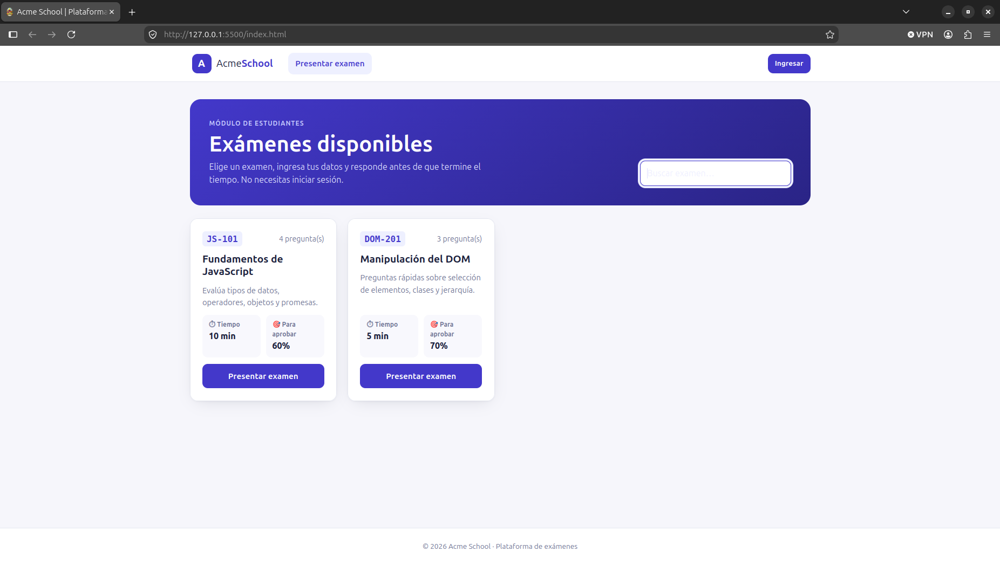
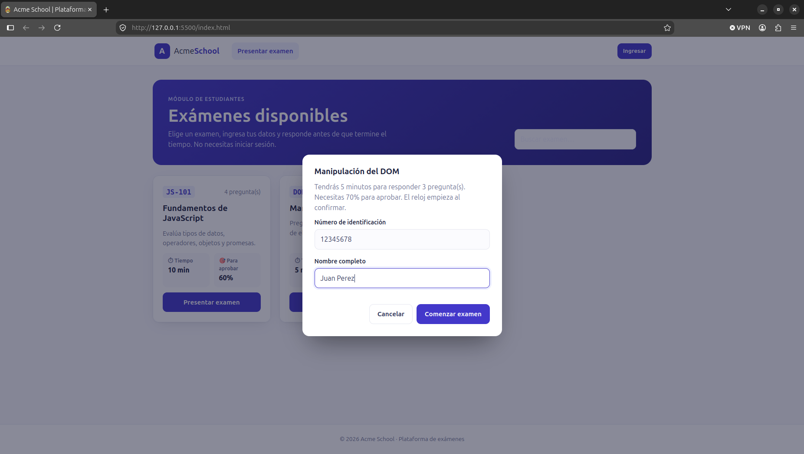
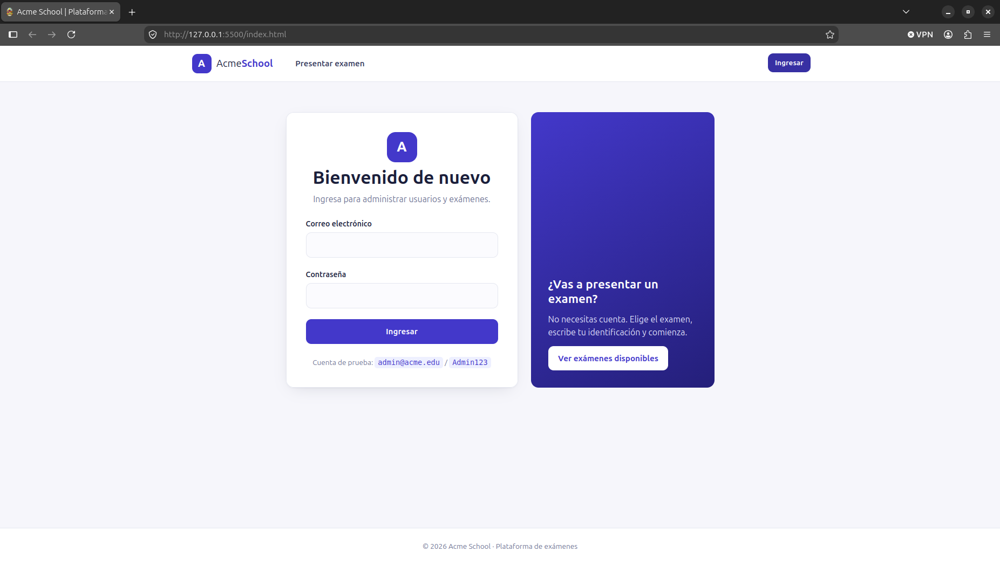
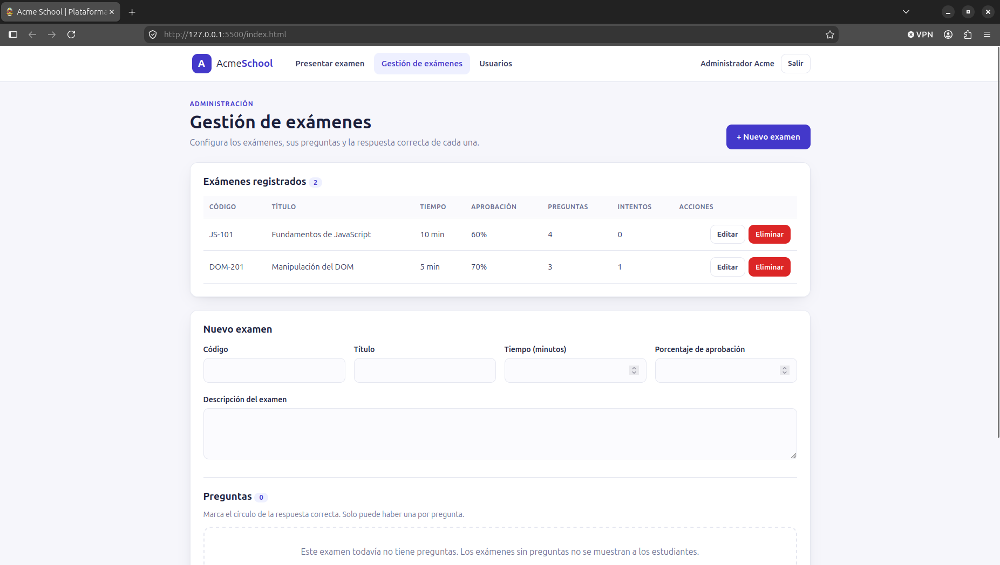
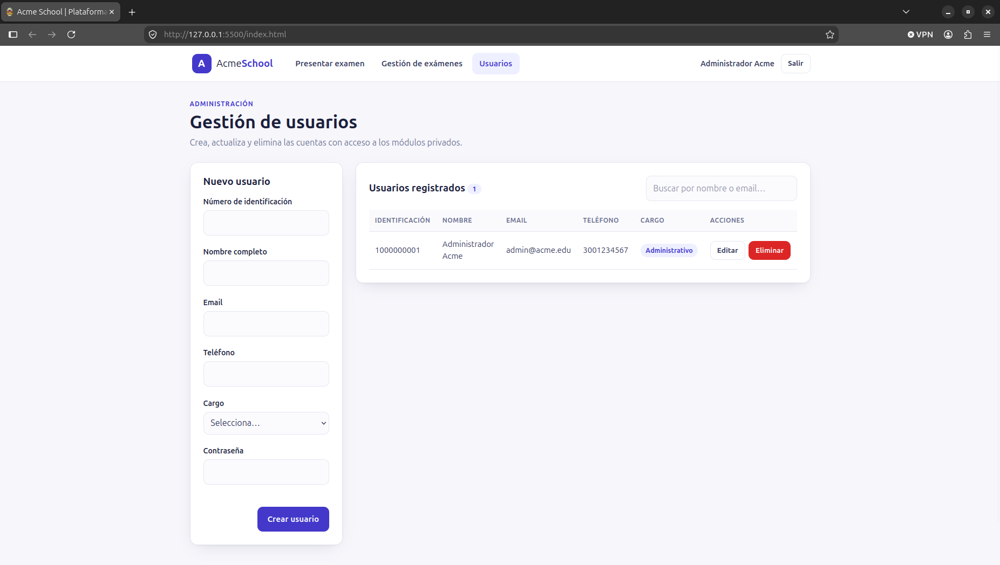
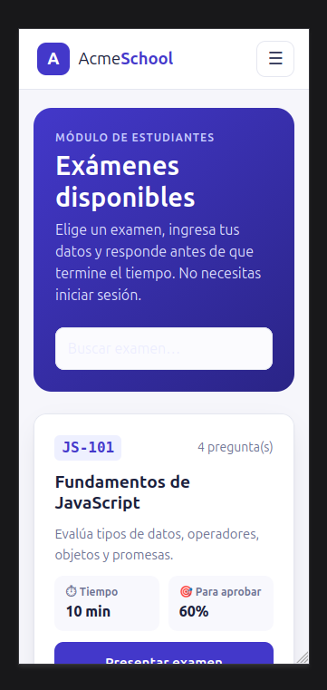

# Acme School | Plataforma de exámenes

Aplicación web hecha con **HTML, CSS y JavaScript**, usando **Web Components** y **localStorage**.
La escuela Acme puede administrar usuarios y exámenes, y los estudiantes pueden presentar exámenes en línea con un reloj en tiempo real.

> Repositorio: `https://github.com/Angiepad09/ProyectoAcmeschool_JavaScript_PadillaAngie`

---

## Cómo ejecutarlo

1. Abre la carpeta en VS Code.
2. Clic `index.html` y en VS Code con **Live Server**.

> Se necesita Live Server porque los datos iniciales se cargan con `fetch("data/semilla.json")`, y `fetch` falla si el HTML se abre con doble clic

---

## Módulos

| Módulo | Acceso | Qué hace |
|---|---|---|
| **Login** | Público | Inicia sesión con email y contraseña. La sesión se guarda en `sessionStorage`. |
| **Gestión de usuarios** | Privado | Tabla de usuarios, formulario de creación/actualización, botones Editar y Eliminar. Campos: identificación, nombre completo, email, teléfono, cargo (Administrativo / Docente) y contraseña. |
| **Gestión de exámenes** | Privado | Tabla de exámenes, formulario, botones Editar y Eliminar. Campos: código, título, tiempo, porcentaje de aprobación y descripción. Cada examen tiene preguntas con respuestas.|
| **Resolución de exámenes** | Público | Lista de exámenes. Pide identificación y nombre, muestra el encabezado, las preguntas numeradas, el reloj y el botón Terminar. Al final muestra el porcentaje y si aprobó. |

---
## Vistas
### 1. Examenes disponibles: `vista-catalogo`
<p align="center"></p>

### 2. Presentar examen: `vista-presentar`
<p align="center"></p>

### 3. Iniciar sesion: `vista-login`
<p align="center"></p>

### 4. Gestion de examenes: `vista-examenes`
<p align="center"></p>

### 5. Gestion de usuarios: `vista-usuarios`
<p align="center"></p>

### 6. Vista Movil:
<p align="center"></p>


---
## Estructura de archivos

```
ProyectoAcmeschool/
├── index.html                    # Estructura, plantilla del reloj y scripts
├── README.md
├── css/
│   ├── base.css                  # Variables de color, estilos generales, botones, tarjetas, formularios
│   ├── componentes.css           # Barra de navegación y modal
│   ├── administracion.css        # Login, tablas, usuarios y editor de exámenes
│   └── estudiantes.css           # Lista de exámenes, examen y resultado
├── data/
│   └── semilla.json              # Datos iniciales
└── js/
    ├── utilidades.js             # Funciones de ayuda (crear elementos, validar, formatear tiempo)
    ├── almacenamiento.js         # localStorage, sessionStorage y carga inicial con fetch
    ├── main.js                   # Punto de entrada
    ├── componentes/
    │   ├── acme-app.js           # <acme-app>        decide qué vista se muestra
    │   ├── acme-encabezado.js    # <acme-encabezado> barra de navegación
    │   ├── acme-modal.js         # <acme-modal>      ventana que devuelve una promesa
    │   ├── acme-aviso.js         # <acme-aviso>      notificaciones
    │   └── acme-temporizador.js  # <acme-temporizador> reloj
    └── vistas/
        ├── vista-login.js
        ├── vista-usuarios.js
        ├── vista-examenes.js
        ├── vista-catalogo.js
        └── vista-presentar.js
```
---

## Web Components

| Componente | Qué demuestra |
|---|---|
| `<acme-temporizador>` | `attachShadow`, **`<template>`** clonado con `cloneNode(true)`, `observedAttributes` + `attributeChangedCallback`, `connectedCallback` y `disconnectedCallback`, eventos personalizados `tiempo-tic` y `tiempo-agotado`. |
| `<acme-aviso>` | Shadow DOM con `<style>` propio, animaciones con `animate()` y `await animacion.finished`. |
| `<acme-modal>` | Método `abrir()` que devuelve una **Promesa** (se usa con `await`), tecla `Escape` con `keydown`, `removeEventListener` con la misma función. |
| `<acme-encabezado>` | Un solo listener para todos los botones (burbujeo + `e.target`), escucha el evento `app:sesion`. |
| `<acme-app>` | Escucha el evento `app:navegar` y protege las vistas privadas. |
| Vistas (`vista-…`) | Cada pantalla es un Custom Element que arma su contenido en `connectedCallback`. |

Comunicación entre componentes con **CustomEvent**:

| Evento | Quién lo emite | Para qué |
|---|---|---|
| `app:navegar` | Cualquier vista o el encabezado | Cambiar de vista |
| `app:sesion` | Login / Salir | Que el encabezado se vuelva a pintar |
| `app:vista-cambiada` | `<acme-app>` | Resaltar el botón activo del menú |
| `tiempo-tic` / `tiempo-agotado` | `<acme-temporizador>` | Guardar el tiempo y terminar el examen |

---

## Persistencia de datos (JSON)

| Llave | Dónde | Contenido |
|---|---|---|
| `acme_usuarios` | localStorage | Arreglo de usuarios |
| `acme_examenes` | localStorage | Arreglo de exámenes con preguntas y respuestas |
| `acme_resultados` | localStorage | Resultados de los exámenes presentados |
| `acme_intento_activo` | localStorage | Examen en curso (respuestas y segundos restantes) |
| `acme_contador` | localStorage | Número para generar ids únicos |
| `acme_sesion` | sessionStorage | `{usuarioId}` del usuario con sesión |
| `acme_vista` | sessionStorage | Última vista abierta (para recargar en el mismo lugar) |

---

## Temporizador

- Al empezar, el examen guarda `segundosRestantes = tiempo × 60`.
- `<acme-temporizador>` guarda la hora en que termina el examen (Date.now() + segundos) y cada segundo calcula el tiempo restante con la hora real, así el reloj no se atrasa aunque el navegador frene los setTimeout en pestañas ocultas.
- Cada segundo emite `tiempo-tic` y la vista guarda el tiempo restante en localStorage. Si se recarga la página, el examen sigue donde iba.
- En el último minuto el reloj se pone rojo.
- Al llegar a 0 emite `tiempo-agotado` y el examen se envía solo.
- Si el componente sale de la página, se detiene.

---

## Limitaciones conocidas

- Es una app 100 % frontend: las contraseñas quedan guardadas en localStorage como texto. En un sistema real se validarían en un servidor.

---
